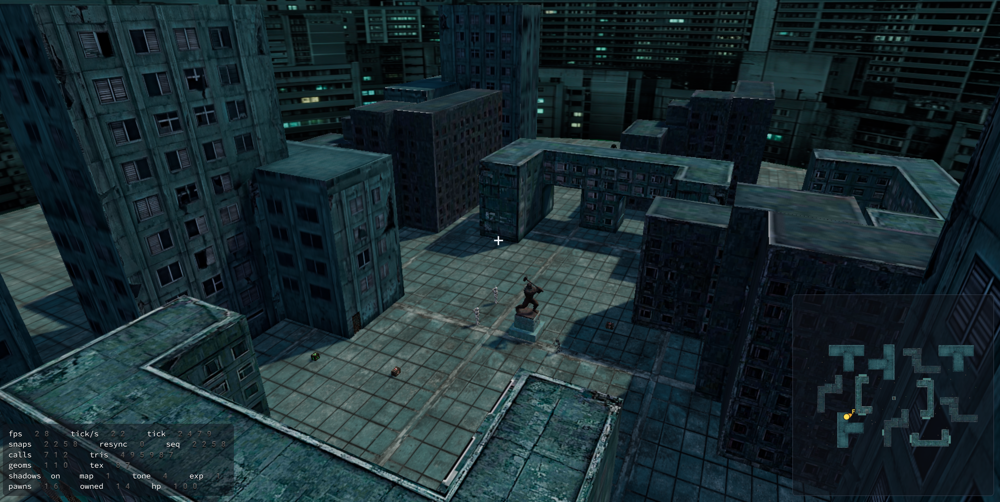

# Conveyor Engine Arena



A browser arena for [Conveyor Engine](https://github.com/autonomous1/conveyor-engine-packages). A Node host owns the simulation and publishes snapshots over a same-origin WebSocket. A Three.js client renders those snapshots: a cityscape bounds, sky, static building placements (often Tripo-derived GLBs), floors and rooms from [blueprint-scene](https://github.com/autonomous1/blueprint-scene) bake output, doors, cover props, and wandering characters.

The server ticks at 20 Hz. Each spawn point gets a pawn. The wander loop picks `idle`, `walk`, `run`, `fall`, or `angry`, plays that clip, and scales movement by that gait’s speed relative to the fastest gait on the model. Connecting a browser assigns a free pawn. The camera is free-fly by default; with pointer lock you can also drive pawn look, fire, and door use.

## Prerequisites

Node.js **24** (tested on 24.0.2; 22+ may work but is not the project target).

Conveyor Engine packages (`conveyor-engine-core`, `conveyor-engine-world`, `conveyor-engine-replication`, `conveyor-engine-client`, `conveyor-engine-three`, and related packages) are published on npm. `npm install` pulls them from the registry.

Scene bake uses **blueprint-scene** (`npm run bake:scene` → `scripts/bake.sh`). Prefer a sibling checkout at `../blueprint-scene` when iterating on bake; the package may also be installed from npm as a dependency.

## Run

```bash
npm install
npm run dev
```

`npm run dev` builds the server and the browser bundle, then starts the host. The process prints a line like:

```json
{"url":"http://127.0.0.1:4173","ws":"ws://127.0.0.1:4173"}
```

Open that URL. The host binds to `127.0.0.1`. Set `PORT` to use another port. After a build, `npm start` launches `dist/server/main.js` without rebuilding.

Static files come from `dist/web`. `/arena.json` is generated in memory from the compiled game file. Paths outside that bundle, including source maps, `node_modules`, and `/pkg`, respond with 404.

## Solo / static deploy

`npm run build:solo` writes a static site to `dist/solo/`. The authoritative host runs in the page and talks to the client through an in-memory socket. There is no Node process and no WebSocket. Serve that directory with any static host:

```bash
npm run build:solo
npx serve dist/solo
```

Open the URL with no query flag. Assets are relative (`./assets/`, `./game/`), so the same build works under a subpath when the URL ends with a slash (`npx serve dist`, then open `/solo/`). `?noclip=1` turns noclip on for that tab.

`npm run build` is unchanged: `dist/web/` plus the Node host. That client bundle does not contain the host. Set `wsUrl` in `web/game/arena.game.json` to a `ws:` or `wss:` URL when the page and the host are on different origins. `?ws=` overrides it for one tab. Omit `wsUrl` and the client uses the page origin, which is what `npm start` does.

## Controls

| Input | Action |
| --- | --- |
| W / Up, S / Down | Forward, back |
| A / Left, D / Right | Strafe |
| R, F | Up, down (fly) |
| Drag (pointer locked) | Look |
| E | Use / open the overlapping door |
| Primary mouse | Fire (while pointer locked; first click locks the pointer) |
| Gamepad | F10 cycles `standard` and `jumper-t`. Maps below. |

Set the F310 switch on the back to X. The browser then reports the standard mapping. A standard pad does not need pointer lock. It does need the window focused. While Options is open the pad does not move, look, fire, throw, or use. Right-stick forward looks up unless Invert look Y is on. D-pad up and down repeat while held, in a cab and in Options. In Options, left-stick up and down repeat the same way: one step on press, then again after a short delay.

| F310 (XInput) | Index | In play | Options open |
| --- | --- | --- | --- |
| RT | button 7 | Fire, held | — |
| LT | button 6 | Grenade, once per squeeze | — |
| A | button 0 | Use the overlapping door. Otherwise, in a cab, confirm the picked stop. Otherwise, on a landing, call the cab | Toggle the focused row |
| B | button 1 | — | Close |
| X | button 2 | Call the cab at the landing | — |
| Y | button 3 | — | — |
| LB / RB | buttons 4 / 5 | Noclip down / up, when noclip is on | — |
| Back | button 8 | Toggle the scene map | Toggle the scene map |
| Start | button 9 | Open or close Options | Close |
| L3 / R3 | buttons 10 / 11 | — | — |
| D-pad up / down | buttons 12 / 13 | In a cab, pick the next higher or lower stop | Move the highlight |
| D-pad left / right | buttons 14 / 15 | — | Change the model choice |
| Logitech button | not reported | — | — |
| Left stick | axes 0 / 1 | Move | Up / down also moves the highlight |
| Right stick | axes 2 / 3 | Look. Forward looks up unless Invert look Y is on | — |

`jumper-t` is a Jumper T-series radio in EdgeTX/OpenTX Mode 2 (AETR). It uses this stick map and binds no buttons. Stick-up looks up unless Invert look Y is on. The throttle has no spring and rests at full back, which moves backward. Full up moves forward.

| Axis | Stick | Use |
| --- | --- | --- |
| 0 | Right, left / right | Look yaw |
| 1 | Right, up / down | Look pitch |
| 3 | Left, left / right | Strafe |
| 2 | Left, up / down | Forward / back |

Pawn intent is driven on the server. A status line at the top shows the connection and how many pawn meshes fell back to capsules. A connected pad shows `pad: …`. If that pad is not in the standard mapping while the standard profile is on, the line warns to set the F310 switch to X.

## Scene bake

Authoring lives under `dev/scenes/` (Inkscape scene SVG, per-building floors SVGs, room SVGs, editable source models). Bake writes placements, collision, doors, and cut building meshes into `web/game/` and `web/assets/models/` (including shared `<model>.cut.glb` for exterior openings).

```bash
npm run bake:scene
```

`scripts/bake.sh` invokes blueprint-scene with `--svg`, `--models`, `--floors`, `--rooms`, `--game`, `--collision-dir`, and `--out`. Re-run bake after changing floors doors, room doors that should affect collision, or building meshes that need facade cuts. Keep editable non-KTX2 sources under `dev/scenes/.../models` and bake KTX2 (or cut) products into `web/assets/models` for the runtime.

## Game file

`web/game/arena.game.json` is the authored game (`worldVersion` `example-v1`). On startup the server compiles it into the static world and the `/arena.json` view the client renders. A bad manifest stops startup with a field path and a message: invalid version, a path that escapes `web/`, a missing file, a model that is not a GLB, or a spawn that intersects an obstacle.

`scene.id` and `scene.bounds` are required. `floor`, `walls`, `sky`, `cityscape`, `shadows`, `spawnPoints`, `props`, `collision`, `doors`, and `placements` are optional. A missing block is left out. Missing spawn points leave the host fallback spawn in place. When `walls` is present, each of `south`, `east`, `north`, and `west` names a model asset, and collision ids 10–13 are reserved for those boxes.

`scene.bounds` is the bounds object, or a path to a JSON file of that object. `scene.spawnPoints` is the wander-pawn array, or a path to a JSON file of that array. `scene.playerSpawnPoints` is the human pad array, or a path to that same `{ id, x, y, z, yaw }` shape. Wander pawns use `spawnPoints` only. A connecting player claims a free `playerSpawnPoints` pad only. A path uses the same rules as a placements file: relative to the arena repo, or into a sibling blueprint-scene checkout when configured that way. A missing file fails the load.

`player.modelChoices` lists the character ids a client can select. Each id is a model with `type` `character` and clips for idle, walk, run, fall, and angry. At least two are required. `player.npcModelChoices` is the wander-pawn pool. When it is omitted, wander pawns use `modelChoices`.

`scene.placements` is a list of placements files. A single path string is accepted as a one-element list. Each file's placements and obstacles are concatenated, and ids must be unique across files. A missing file fails the load. A placement file may also carry `scene.spawnPoints`, `scene.props`, and `scene.collision`, which are appended. It does not replace `floor`, `sky`, `cityscape`, `shadows`, or the manifest `bounds`. Building and room placements from bake typically live in files such as `buildings.placements.json`, `rooms.placements.json`, and `doors.placements.json`.

`scene.shadows.quality` is `off`, `basic`, `soft`, or `realistic`. `realistic` is a 4096 variance shadow map, `soft` is PCF at 2048, and `basic` is an unfiltered 512 map.

Character models map `idle`, `walk`, `run`, `fall`, and `angry` to a GLB clip name, or to `{ "clip", "speed" }`. Omitted speeds default to idle 0, walk 1, run 2, fall 0, angry 0. Clip lookup uses the exact name, then a case-insensitive substring. A positive finite `scale` (default 1) is applied to the character template before pawns spawn. A missing or failed character model draws a capsule and leaves the simulation hash unchanged.

Two hashes ride along in the view:

- `authoritativeHash` covers collision, spawns, bounds, and visual layout identity. Changing walls, cover, or spawns changes it, and connected clients must reconnect.
- `presentationHash` covers texture and model bytes. Swapping those files leaves the authoritative hash alone.

Each asset keeps its own license id and provenance origin.

## Scripts

| Script | What it does |
| --- | --- |
| `npm run dev` | Build, then start the live host |
| `npm start` | Start `dist/server/main.js` |
| `npm run build` | Clean `dist/`, compile the server with `tsc`, bundle the client with esbuild, check the web bundle, then build the solo site |
| `npm run build:solo` | Static `dist/solo/` with the host inside the page. `npm run build` runs this too |
| `npm run typecheck` | Typecheck server, client, and util without emitting |
| `npm test` | Node’s test runner. Requires a prior `npm run build` |
| `npm run token` | Keygen, mint, list, and revoke Ed25519 access tokens |
| `npm run bake:scene` | Run `scripts/bake.sh` (blueprint-scene → `web/game` + cut models) |
| `npm run bake:map` | Top-down PNG of the arena into `web/assets/map-bake.png` |
| `npm run start:arena` | Headless arena for 8 ticks (`npm run start:arena-wall` runs 40) |
| `npm run start:arena-miss` | Same path with presentation assets marked missing |
| `npm run run:lossless` | Headless runner, clean delivery |
| `npm run run:lossy` | Headless runner, loss and jitter |
| `npm run run:partition` | Headless runner, a temporary partition |
| `npm run bench` | Headless bench, default 200 entities and 30 ticks (`npm run bench -- 1000 120`) |
| `npm run record:arena` | Record a wander trace |

`node scripts/make-placeholders.mjs` writes original procedural stand-ins under `web/assets` when needed. The game file is what the server loads; point an asset `uri` at a new file for it to appear in the scene.

## Authentication

Auth is off by default. Set `ARENA_AUTH=required` (exact value) on the Node host to gate WebSocket joins. Anything else, including unset, leaves the gate off: a bad or missing key is ignored.

When auth is required, `/arena.json` includes `"authRequired": true`. The browser client (`src/client/main.ts`) then redirects to `/landing-page.html#play` unless sessionStorage (or localStorage, if Remember was checked) holds a usable key under `ce-arena-auth`. The solo bundle defines `__ARENA_SOLO__` as true, never redirects for auth, and never puts `auth` on hello.

### Tokens

Access tokens are Ed25519-signed JWTs (`jose`, algorithm `EdDSA`). They are signed, not encrypted. Claims are `sub`, `role`, `scope`, `jti`, `iat`, and `exp`. Issuer and audience are both `ce-arena`. Verification allows 30 seconds of clock skew. A `jti` on the revocation list is rejected.

Roles are `player`, `bot`, `qa`, and `admin`. Scopes are `play`, `spectate`, `scene-graph`, `qa`, `teleport`, `chat`, `voice`, and `admin`. Minting starts from the role's default scopes and adds any `--scope` values. The hello gate admits only roles in that set whose `scope` includes `play`.

| Role | Default scopes |
| --- | --- |
| `player` | `play`, `chat`, `voice` |
| `bot` | `play`, `chat` |
| `qa` | `play`, `spectate`, `scene-graph`, `qa` |
| `admin` | every scope |

Default token lifetime is **30 days**. Pass `--days N` or `--hours N` (not both).

### Keys and env

Private keys stay outside this repo. The CLI refuses to write inside the working tree. The default directory is `~/.config/ce-arena/`. Set `ARENA_CONFIG_DIR` to move it.

| Variable | Default | Use |
| --- | --- | --- |
| `ARENA_AUTH` | (unset = off) | `required` turns the hello gate on. Any other value is off. |
| `ARENA_VERIFY_KEY_FILE` | **none** (required when auth is on) | Public SPKI PEM the host loads to verify. No built-in path fallback. |
| `ARENA_CONFIG_DIR` | `~/.config/ce-arena` | Base directory. Also holds `issued.jsonl`. |
| `ARENA_SIGNING_KEY_FILE` | `$ARENA_CONFIG_DIR/ed25519.key.pem` | Private PKCS8 PEM used by `npm run token -- mint`. |
| `ARENA_REVOKED_FILE` | `$ARENA_CONFIG_DIR/revoked.json` | JSON array of revoked `jti` values. A missing file revokes nothing. Unset uses that default path on the host. |

`issued.jsonl` records one JSON object per mint: `jti`, `sub`, `role`, `scope`, and `exp`. The token itself is not stored.

### Generate a host keypair

Build so `dist/server/auth/token-cli.js` exists (`npm run build` or at least `npm run build:server`), then:

```bash
npm run token -- keygen
# or: npm run token -- keygen --out ~/.config/ce-arena/ed25519
```

Writes `<prefix>.key.pem` and `<prefix>.pub.pem`, both mode `0600`. Default prefix is `$ARENA_CONFIG_DIR/ed25519`. Point the host at the **public** file only.

### Mint a player token

```bash
npm run token -- mint --role player --sub alice
npm run token -- mint --role bot --sub bot-1 --scope scene-graph,teleport --days 30
npm run token -- mint --role qa --sub qa-1 --hours 12 --out /tmp/qa.token
npm run token -- list
npm run token -- revoke <jti>
```

`mint` prints the JWT to stdout, or writes it mode `0600` when `--out` is set. `list` prints each issued record with its expiry and whether that `jti` is revoked.

### Start the host with auth required

```bash
ARENA_AUTH=required ARENA_VERIFY_KEY_FILE=~/.config/ce-arena/ed25519.pub.pem npm start
```

`openAuthGate` in `src/server/main.ts` throws immediately if `ARENA_AUTH=required` and `ARENA_VERIFY_KEY_FILE` is missing or unreadable:

```text
Error: ARENA_AUTH=required needs ARENA_VERIFY_KEY_FILE
```

Local / everyday play: leave `ARENA_AUTH` unset and run `npm run dev` or `npm start` as usual.

### Join via the landing page

1. Open `http://127.0.0.1:4173/landing-page.html` (or `/play`, which serves the same file).
2. Paste the minted JWT into **Auth key**, optionally check **Remember on this device**, click **Play**.
3. The page stores the key under `ce-arena-auth` in `sessionStorage` always, and in `localStorage` only when Remember is checked (`src/client/auth-key.ts`). It then navigates to `/`.
4. On WebSocket `hello`, the client sends that string as `auth` (separate from the reconnect `token` field). The host verifies it before admitting the connection.

Close codes from the gate (`src/server/auth/gate.ts`):

| Code | When |
| --- | --- |
| `4401` | Missing `auth`, bad/expired/revoked signature or claims, verify timeout, or queue overflow |
| `4403` | Verified token whose role is not allowed or whose `scope` lacks `play` |

On `4401` / `4403` the client clears `ce-arena-auth` and returns to `/landing-page.html#play` with a short status message.

`web/index.html` is still the game page. It does not collect a key; with auth required and no stored key it redirects to the landing page. `/` serves `index.html`; `/play` serves `landing-page.html`.

### Solo build

`npm run build:solo` needs no auth. The in-tab host has no WebSocket gate. The solo landing page strips the `<!-- play:start -->` … `<!-- play:end -->` block (no paste form, no `auth-key.js`).

### Troubleshooting

- **`ARENA_AUTH=required needs ARENA_VERIFY_KEY_FILE`** — set `ARENA_VERIFY_KEY_FILE` to the `.pub.pem` from `keygen`, not the private `.key.pem`.
- **Access denied / bounce to landing after a reject** — mint a fresh player (or bot/qa/admin) token with `play` in scope; confirm the host public key matches the keypair that signed it.
- **Stale or bad key stuck in the browser** — Sign out on the landing page, or clear site data for the origin (clears `sessionStorage` / `localStorage` `ce-arena-auth`). An expired key is dropped on load by `loadKey`.
- **Old key still “works” while testing** — auth is probably off. Only `ARENA_AUTH=required` enables the gate.

## Layout

```text
src/server/   HTTP host, manifest compile, world load, wander tick
src/client/   Browser bootstrap, scene, doors, pawn presentation, camera, HUD
src/util/     Map bake (not part of the client or server build)
src/shared/   Arena view, movement names, shadow settings
src/          Headless ExampleApp, runners, bench, wander recording
dev/scenes/   Authoring SVGs and editable source models (pre-bake)
web/game/     arena.game.json and bake outputs (placements, doors, collision)
web/assets/   Runtime models and textures (including .cut.glb / KTX2 products)
web/index.html
scripts/      Client bundle, bake.sh, placeholder art
test/         Manifest, host, movement, shadows, doors, static world
dist/         Build output (host serves dist/web, runs dist/server)
```

## Tests

```bash
npm run build
npm test
npm run typecheck
```

`npm test` uses `node --experimental-strip-types`. Several tests import the built `dist/` modules, and the host test requests `/` and `/client.js`, so run a full build first.
