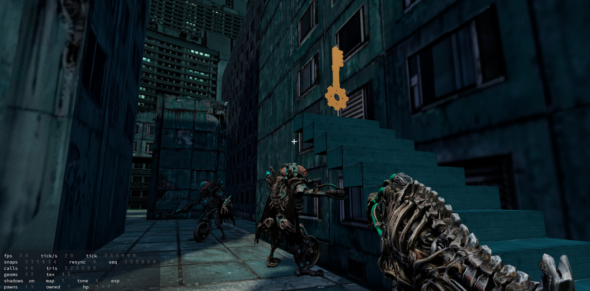

# Conveyor Engine Arena



A browser arena for [Conveyor Engine](https://github.com/autonomous1/conveyor-engine-packages). A Node host owns the simulation and publishes snapshots over a same-origin WebSocket. A Three.js client renders those snapshots: a cityscape bounds, sky, static building placements (often Tripo-derived GLBs), floors and rooms from [blueprint-scene](https://github.com/autonomous1/blueprint-scene) bake output, doors, cover props, and wandering characters.

The server ticks at 20 Hz. Each spawn point gets a pawn. The wander loop picks `idle`, `walk`, `run`, `fall`, or `angry`, plays that clip, and scales movement by that gait’s speed relative to the fastest gait on the model. Connecting a browser assigns a free pawn. The camera is free-fly by default; with pointer lock you can also drive pawn look, fire, and door use.

## Prerequisites

Node.js **24** (tested on 24.0.2; 22+ may work but is not the project target).

Conveyor Engine packages (`conveyor-engine-core`, `conveyor-engine-world`, `conveyor-engine-replication`, `conveyor-engine-client`, `conveyor-engine-three`, and related packages) are published on npm. `npm install` pulls them from the registry.

Scene bake uses **blueprint-scene** (`npm run bake:scene` → `scripts/bake.sh`). Prefer a sibling checkout at `../blueprint-scene` when iterating on bake; the package may also be installed from npm as a dependency.

## Run

```bash
npm install
npm run dev
```

`npm run dev` builds the server and the browser bundle, then starts the host. The process prints a line like:

```json
{"url":"http://127.0.0.1:4173","ws":"ws://127.0.0.1:4173"}
```

Open that URL. The host binds to `127.0.0.1`. Set `PORT` to use another port. After a build, `npm start` launches `dist/server/main.js` without rebuilding.

Static files come from `dist/web`. `/arena.json` is generated in memory from the compiled game file. Paths outside that bundle, including source maps, `node_modules`, and `/pkg`, respond with 404.

## Controls

| Input | Action |
| --- | --- |
| W / Up, S / Down | Forward, back |
| A / Left, D / Right | Strafe |
| R, F | Up, down (fly) |
| Drag (pointer locked) | Look |
| E | Use / open the overlapping door |
| Primary mouse | Fire (while pointer locked; first click locks the pointer) |
| Gamepad | Same camera fly; right stick look is inverted vs `three-gamepad-controls` default |

Pawn intent is driven on the server. A status line at the top shows the connection and how many pawn meshes fell back to capsules.

## Scene bake

Authoring lives under `dev/scenes/` (Inkscape scene SVG, per-building floors SVGs, room SVGs, editable source models). Bake writes placements, collision, doors, and cut building meshes into `web/game/` and `web/assets/models/` (including shared `<model>.cut.glb` for exterior openings).

```bash
npm run bake:scene
```

`scripts/bake.sh` invokes blueprint-scene with `--svg`, `--models`, `--floors`, `--rooms`, `--game`, `--collision-dir`, and `--out`. Re-run bake after changing floors doors, room doors that should affect collision, or building meshes that need facade cuts. Keep editable non-KTX2 sources under `dev/scenes/.../models` and bake KTX2 (or cut) products into `web/assets/models` for the runtime.

## Game file

`web/game/arena.game.json` is the authored game (`worldVersion` `example-v1`). On startup the server compiles it into the static world and the `/arena.json` view the client renders. A bad manifest stops startup with a field path and a message: invalid version, a path that escapes `web/`, a missing file, a model that is not a GLB, or a spawn that intersects an obstacle.

`scene.id` and `scene.bounds` are required. `floor`, `walls`, `sky`, `cityscape`, `shadows`, `spawnPoints`, `props`, `collision`, `doors`, and `placements` are optional. A missing block is left out. Missing spawn points leave the host fallback spawn in place. When `walls` is present, each of `south`, `east`, `north`, and `west` names a model asset, and collision ids 10–13 are reserved for those boxes.

`scene.bounds` is the bounds object, or a path to a JSON file of that object. `scene.spawnPoints` is the wander-pawn array, or a path to a JSON file of that array. `scene.playerSpawnPoints` is the human pad array, or a path to that same `{ id, x, y, z, yaw }` shape. Wander pawns use `spawnPoints` only. A connecting player claims a free `playerSpawnPoints` pad only. A path uses the same rules as a placements file: relative to the arena repo, or into a sibling blueprint-scene checkout when configured that way. A missing file fails the load.

`player.modelChoices` lists the character ids a client can select. Each id is a model with `type` `character` and clips for idle, walk, run, fall, and angry. At least two are required. `player.npcModelChoices` is the wander-pawn pool. When it is omitted, wander pawns use `modelChoices`.

`scene.placements` is a list of placements files. A single path string is accepted as a one-element list. Each file's placements and obstacles are concatenated, and ids must be unique across files. A missing file fails the load. A placement file may also carry `scene.spawnPoints`, `scene.props`, and `scene.collision`, which are appended. It does not replace `floor`, `sky`, `cityscape`, `shadows`, or the manifest `bounds`. Building and room placements from bake typically live in files such as `buildings.placements.json`, `rooms.placements.json`, and `doors.placements.json`.

`scene.shadows.quality` is `off`, `basic`, `soft`, or `realistic`. `realistic` is a 4096 variance shadow map, `soft` is PCF at 2048, and `basic` is an unfiltered 512 map.

Character models map `idle`, `walk`, `run`, `fall`, and `angry` to a GLB clip name, or to `{ "clip", "speed" }`. Omitted speeds default to idle 0, walk 1, run 2, fall 0, angry 0. Clip lookup uses the exact name, then a case-insensitive substring. A positive finite `scale` (default 1) is applied to the character template before pawns spawn. A missing or failed character model draws a capsule and leaves the simulation hash unchanged.

Two hashes ride along in the view:

- `authoritativeHash` covers collision, spawns, bounds, and visual layout identity. Changing walls, cover, or spawns changes it, and connected clients must reconnect.
- `presentationHash` covers texture and model bytes. Swapping those files leaves the authoritative hash alone.

Each asset keeps its own license id and provenance origin.

## Scripts

| Script | What it does |
| --- | --- |
| `npm run dev` | Build, then start the live host |
| `npm start` | Start `dist/server/main.js` |
| `npm run build` | Clean `dist/`, compile the server with `tsc`, bundle the client with esbuild |
| `npm run typecheck` | Typecheck server, client, and util without emitting |
| `npm test` | Node’s test runner. Requires a prior `npm run build` |
| `npm run bake:scene` | Run `scripts/bake.sh` (blueprint-scene → `web/game` + cut models) |
| `npm run bake:map` | Top-down PNG of the arena into `web/assets/map-bake.png` |
| `npm run start:arena` | Headless arena for 8 ticks (`npm run start:arena-wall` runs 40) |
| `npm run start:arena-miss` | Same path with presentation assets marked missing |
| `npm run run:lossless` | Headless runner, clean delivery |
| `npm run run:lossy` | Headless runner, loss and jitter |
| `npm run run:partition` | Headless runner, a temporary partition |
| `npm run bench` | Headless bench, default 200 entities and 30 ticks (`npm run bench -- 1000 120`) |
| `npm run record:arena` | Record a wander trace |

`node scripts/make-placeholders.mjs` writes original procedural stand-ins under `web/assets` when needed. The game file is what the server loads; point an asset `uri` at a new file for it to appear in the scene.

## Layout

```text
src/server/   HTTP host, manifest compile, world load, wander tick
src/client/   Browser bootstrap, scene, doors, pawn presentation, camera, HUD
src/util/     Map bake (not part of the client or server build)
src/shared/   Arena view, movement names, shadow settings
src/          Headless ExampleApp, runners, bench, wander recording
dev/scenes/   Authoring SVGs and editable source models (pre-bake)
web/game/     arena.game.json and bake outputs (placements, doors, collision)
web/assets/   Runtime models and textures (including .cut.glb / KTX2 products)
web/index.html
scripts/      Client bundle, bake.sh, placeholder art
test/         Manifest, host, movement, shadows, doors, static world
dist/         Build output (host serves dist/web, runs dist/server)
```

## Tests

```bash
npm run build
npm test
npm run typecheck
```

`npm test` uses `node --experimental-strip-types`. Several tests import the built `dist/` modules, and the host test requests `/` and `/client.js`, so run a full build first.
